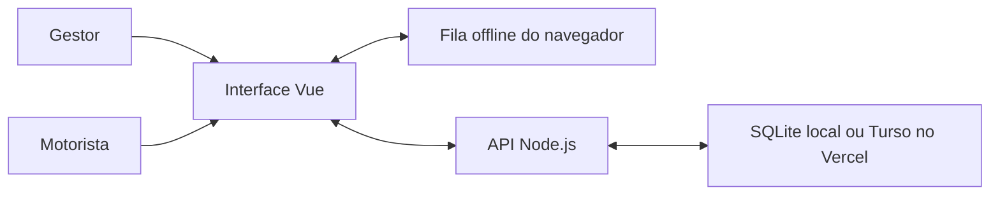

<div align="center">
  
  <h1>Rota Leite</h1>
  <p><strong>Planejamento e registro de coletas de leite em Colméia, Tocantins</strong></p>
  <p>
    <a href="#por-que-o-rota-leite">Contexto</a> ·
    <a href="#como-funciona">Como funciona</a> ·
    <a href="#execução-local">Como rodar</a> ·
    <a href="#implantação">Implantação</a>
  </p>
</div>

**Portfólio de gestão de projetos** · [Case de implantação em inglês](docs/implementation-case-study.md)

## Por que o Rota Leite?

A coleta de leite exige que o laticínio organize a ordem das visitas, acompanhe os volumes e saiba rapidamente quais paradas tiveram problemas. Em Colméia, a dispersão dos fornecedores é um dos desafios logísticos descritos no estudo da Embrapa sobre a cadeia do leite. Uma dificuldade que o projeto decidiu tratar é o repasse das informações da coleta entre o motorista e o gestor, inclusive quando a equipe fica sem conexão. [Estudo da Embrapa](https://www.infoteca.cnptia.embrapa.br/infoteca/handle/doc/1190705)

O **Rota Leite** foi desenvolvido como MVP de Engenharia de Software para reunir esse fluxo em um sistema web. A solução permite planejar o roteiro no computador, registrar o que aconteceu em cada propriedade pelo celular e gerar um relatório da rota ao final da operação.

### O que a solução entrega

| Necessidade | Funcionalidade |
| --- | --- |
| Organizar a coleta do dia | Cadastro de propriedades, rota com paradas ordenadas e volume previsto. |
| Acompanhar as visitas | Registro de litros coletados, ocorrências e motivos por parada. |
| Trabalhar com internet instável | Consulta à rota já carregada, registro offline e sincronização ao recuperar a conexão. |
| Rastrear correções | Histórico com valor anterior, valor novo, autor, horário e motivo. |
| Separar responsabilidades | Gestor planeja e encerra as rotas. Motorista consulta e registra somente as rotas atribuídas à sua conta. |
| Conferir o resultado | Painel por data e CSV com totais, detalhes das paradas, ocorrências e paradas sem registro. |

## Como funciona

1. O **gestor** cadastra as propriedades, define a ordem das paradas e atribui a rota a um motorista.
2. O **motorista** abre a rota com internet antes de sair. A cada visita, informa os litros coletados ou o motivo da ocorrência.
3. Sem internet, os registros ficam na fila do navegador. Quando a conexão volta, a API confere a conta, a rota e cada registro antes de aceitá-lo.
4. Se um valor precisar de correção, o usuário informa o motivo. A versão anterior continua disponível no histórico da parada.
5. O gestor confere o resumo, **encerra a rota** e baixa o CSV. O fechamento bloqueia alterações nas paradas e mantém as ocorrências e pendências no relatório.

> Se outro aparelho registrar uma alteração antes da sincronização, o sistema preserva o registro local em **Registros para revisar**. A nova correção deve partir da versão sincronizada.

## Arquitetura



- **Interface** com Vue 3, Vite e CSS responsivo. Inclui navegação por teclado, campos com rótulos, foco visível e status em texto.
- **Modo offline** com Service Worker e armazenamento local por perfil. A fila usa identificadores únicos para evitar que o reenvio duplique uma coleta.
- **API** em JavaScript. As validações de acesso são feitas no servidor. Gravações usam consultas parametrizadas, limites de requisições e verificações de origem.
- **Banco** SQLite no desenvolvimento e Turso na configuração do Vercel. As migrações são versionadas em `drizzle/`.
- **Autenticação hospedada** com Google OpenID Connect e cookies de sessão assinados. Motoristas podem enviar registros de rotas abertas que lhes foram atribuídas.

### Organização do código

| Caminho | Responsabilidade |
| --- | --- |
| `src/` | Componentes Vue, painel, histórico, sincronização e CSV. |
| `public/` | Estilos, marca e Service Worker. |
| `api/` | Entrada da API na hospedagem Vercel. |
| `server/` | Regras de negócio, autorização e integração com banco e login. |
| `drizzle/` | Esquema e migrações. |
| `scripts/` | Desenvolvimento local, compilação e migração do banco. |
| `test/` | Testes automatizados da API, do CSV e da adaptação ao Vercel. |

## Execução local

**Pré-requisito** Node.js 24 ou posterior.

```bash
npm ci
npm run dev
```

Abra [localhost:3000](http://localhost:3000). O servidor local usa um perfil gestor de demonstração e cria o banco em `.data/rota-leite.sqlite`. Use dados fictícios nesse ambiente.

Para uma demonstração, abra **Rotas → Rota Barreiro**, confira os registros iniciais e teste o fechamento. Para observar a fila offline, carregue primeiro uma rota aberta, desconecte a internet e registre uma parada. Reabra a conexão para sincronizar.

```bash
# Rodar os testes automatizados
npm test

# Gerar a interface direcionada ao Vercel
npm run build:vercel
```

## Implantação

Importe o repositório no Vercel e configure o endereço HTTPS, o banco Turso e o cliente OAuth Google. O [guia de implantação](VERCEL.md) detalha as variáveis, a configuração do login e as migrações. O modelo de variáveis em [`.env.vercel.example`](.env.vercel.example) contém apenas nomes e valores de exemplo.

## Dados e limites do MVP

| Conteúdo | Origem |
| --- | --- |
| Produção de leite de Colméia: **18.456.000 L em 2025** e **16.699.000 L em 2024** | Pesquisa da Pecuária Municipal do IBGE, município 1716703. [SIDRA, tabela 74](https://sidra.ibge.gov.br/tabela/74) · [Consulta dos valores divulgados](https://notop10.com.br/to/cidades-que-mais-produzem-leite) |
| Propriedades, rotas e coletas pré-carregadas | Dados fictícios identificados na interface como demonstração. |

O MVP trabalha com rotas planejadas manualmente. A eficácia em uma operação real ainda depende de piloto com uma equipe de coleta. Indicadores para esse piloto incluem o tempo de fechamento, a proporção de ocorrências com motivo registrado e o número de registros duplicados.

---

**Projeto de Engenharia de Software** · [Raquel Aires](https://github.com/RaquelAires) · Ulbra Palmas
