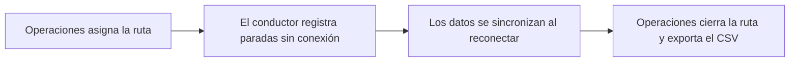

  

# Rota Leite | Caso de implantación y gestión de la entrega

[Português](implementation-case-study.pt-BR.md) · [English](implementation-case-study.md) · [Español](implementation-case-study.es.md)

> Gestión de proyectos tecnológicos · Recogida sin conexión · Piloto propuesto

Rota Leite es un MVP académico para planificar y registrar rutas de recogida de leche en Colméia, Tocantins, Brasil. La persona responsable de la operación planifica y cierra la ruta. El conductor registra volúmenes e incidencias desde el móvil, incluso en tramos sin conexión.

**Funciones del MVP:** orden manual de paradas, asignación de conductor, registro sin conexión y sincronización, historial de correcciones, cierre e informe CSV. La demostración utiliza datos ficticios.  
**Piloto propuesto:** una persona responsable de la operación, un conductor y una ruta. El calendario, los objetivos y los ejemplos de decisión son simulados. El impacto en campo está pendiente de medición.

[Cómo ejecutar la demostración](../README.md#execução-local) · [Guía de despliegue](../VERCEL.md)

## De la planificación a la conciliación

## Alcance y responsabilidades

El piloto abarca desde la asignación de la ruta hasta la conciliación del informe CSV. La coordinación del piloto supervisa la entrega, operaciones aprueba el flujo, el conductor valida el uso en el móvil y la persona responsable del entorno técnico prepara el despliegue y atiende incidencias.

| Criterio de aceptación | Evidencia esperada |
| --- | --- |
| Acceso por asignación | El conductor asignado puede abrir la ruta. Se deniega el acceso a otro conductor. |
| Registro sin conexión | Al recuperar la conexión y repetir la sincronización, el registro aparece una sola vez y el recuento coincide con el esperado. |
| Conflicto entre dispositivos | La anotación queda disponible para revisión. Una corrección sobre la versión sincronizada conserva el motivo en el historial. |
| Cierre de ruta | Los totales del CSV coinciden con las paradas. El informe incluye incidencias y paradas sin registro, y el cierre impide nuevas ediciones. |

## Plan de implantación

| Semana | Hito y responsable | Evidencia para avanzar |
| --- | --- | --- |
| 1 · Preparación | Coordinación acuerda el alcance y la línea base con operaciones. El equipo técnico configura Vercel, Turso y el acceso con Google en pruebas. | Cuentas de operaciones y conductor verificadas y datos ficticios identificados. |
| 2 · Ensayo | Operaciones y el conductor ensayan el flujo en el móvil previsto. El equipo técnico prueba sincronización, cierre y exportación. | Todos los criterios de aceptación se cumplen y operaciones aprueba una ruta piloto. |
| 3 · Piloto | El conductor realiza una ruta. Operaciones compara el CSV con el registro habitual. Coordinación revisa resultados y pendientes. | Decisión registrada de repetir, ampliar o pausar, con responsables y fechas. |

**Cuándo avanzar o pausar.** Iniciar con cuentas verificadas, ruta cargada antes de salir, pruebas críticas aprobadas y un proceso alternativo preparado. Ante un fallo de acceso, registro o conciliación, pausar el piloto, utilizar el proceso habitual y preservar los registros pendientes. El equipo técnico investiga y operaciones autoriza la reanudación tras la conciliación.

## Riesgos y respuestas

| Riesgo | Respuesta | Responsable |
| --- | --- | --- |
| Pérdida de conexión antes de abrir la ruta | Añadir la apertura en línea a la lista de salida y mantener disponible el proceso habitual. | Conductor |
| Duplicados o conflictos entre dispositivos | Ensayar los reintentos, revisar discrepancias y cotejar con el registro de campo. | Equipo técnico y operaciones |
| Fallo de inicio de sesión | Verificar las dos cuentas en pruebas y escalar cualquier bloqueo antes de la salida. | Equipo técnico |
| Datos ficticios mezclados con el piloto | Revisar el conjunto de datos e identificar o retirar los registros de demostración de la vista operativa. | Coordinación |

## Decisión de alcance y comunicación

**Cambio simulado.** Tras el ensayo, operaciones solicita optimización automática de rutas. Se propone aplazarla. El orden manual cubre el piloto, mientras que la optimización requiere datos de ubicación y validación específica. Coordinación registra la solicitud para revisarla después del piloto y mantiene la fecha y los criterios de aceptación acordados.

**Informe semanal simulado · Semana 2 · Ámbar.** Se ensayaron la asignación y el cierre. La apertura de sesión en el móvil de campo sigue siendo una dependencia. El equipo técnico repite la prueba antes de la salida y operaciones decide si autoriza el piloto. Si falla, se repite el ensayo y se conserva el proceso habitual durante ese turno.

## Indicadores del piloto

| Indicador | Cómo medirlo y decidir |
| --- | --- |
| Tiempo de cierre | Medir desde la última parada hasta la validación del informe. Comparar la misma ruta con el proceso habitual y revisar los aumentos antes de ampliar. |
| Incidencias con motivo | Dividir las incidencias con motivo entre el total. Objetivo propuesto del 100%. Los turnos sin incidencias quedan como no aplicables. |
| Duplicados por reintentos | Cotejar los registros con las anotaciones del conductor y repetir la sincronización. Objetivo propuesto de cero duplicados por reenvío. |
| Registros pendientes de sincronización | Contar las anotaciones en cola o revisión en el momento de la aprobación. Objetivo propuesto de cero pendientes. |

Al cerrar el piloto, conservar el CSV sin datos sensibles, la lista de aceptación completada, las actualizaciones de riesgos y decisiones y la aprobación de operaciones. Esta evidencia sirve para decidir si se amplía la implantación.
