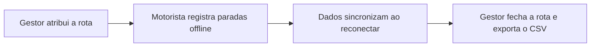

  

# Rota Leite | Case de implantação e gestão da entrega

[Português](implementation-case-study.pt-BR.md) · [English](implementation-case-study.md) · [Español](implementation-case-study.es.md)

> Gestão de projetos de tecnologia · Coleta offline · Proposta de piloto

O Rota Leite é um MVP acadêmico para organizar e registrar rotas de coleta de leite em Colméia, Tocantins. O gestor planeja e fecha a rota. O motorista registra volumes e ocorrências pelo celular, inclusive durante trechos sem conexão.

**O que existe hoje:** ordenação manual de paradas, atribuição de motorista, registro offline e sincronização, histórico de correções, fechamento e exportação CSV. A demonstração usa dados fictícios.  
**O que o case propõe:** um piloto com um gestor, um motorista e uma rota. Cronograma, metas e exemplos de decisão são simulados. O impacto em campo ainda precisa ser medido.

[Como executar a demonstração](../README.md#execução-local) · [Guia de implantação](../VERCEL.md)

## Do planejamento à conferência

## Escopo e responsabilidades

O piloto cobre da atribuição da rota à conferência do CSV. O coordenador acompanha a entrega, o gestor aprova o fluxo operacional, o motorista valida o uso no celular e o responsável técnico prepara o ambiente e trata defeitos.

| Critério de aceite | Evidência esperada |
| --- | --- |
| Acesso por atribuição | O motorista atribuído acessa a rota. Uma conta de outro motorista tem acesso negado. |
| Registro offline | Após reconectar e repetir a sincronização, o registro aparece uma única vez e a contagem bate com o esperado. |
| Conflito entre aparelhos | A entrada fica disponível para revisão. Uma correção sobre a versão sincronizada preserva o motivo no histórico. |
| Fechamento da rota | Os totais do CSV batem com as paradas. Ocorrências e paradas sem registro continuam visíveis, e o fechamento bloqueia novas edições. |

## Plano de implantação

| Semana | Marco e responsável | Evidência para avançar |
| --- | --- | --- |
| 1 · Preparação | Coordenador alinha escopo e linha de base com o gestor. Responsável técnico configura Vercel, Turso e login Google em homologação. | Contas de gestor e motorista validadas e dados fictícios identificados. |
| 2 · Ensaio | Gestor e motorista executam o fluxo no celular que será usado. Responsável técnico testa a sincronização, o fechamento e o CSV. | Critérios de aceite atendidos e aprovação do gestor para iniciar uma rota piloto. |
| 3 · Piloto | Motorista executa uma rota. Gestor confere o CSV com o registro atual. Coordenador revisa resultados e pendências. | Decisão registrada para repetir, ampliar ou pausar, com responsáveis e prazos. |

**Quando avançar ou pausar.** Avance com contas validadas, rota carregada antes da saída, testes críticos aprovados e processo alternativo preparado. Se o login, o registro ou a conferência falhar em campo, pause o piloto, acione o processo atual de coleta e preserve os registros pendentes. O responsável técnico investiga e o gestor aprova a retomada após a conferência.

## Riscos e respostas

| Risco | Resposta | Responsável |
| --- | --- | --- |
| Perda de sinal antes de carregar a rota | Incluir a abertura da rota online na lista de saída e manter o processo atual disponível. | Motorista |
| Duplicidade ou conflito entre aparelhos | Ensaiar nova tentativa de sincronização, revisar divergências e conferir com o registro de campo. | Responsável técnico e gestor |
| Falha de login | Testar as duas contas no ambiente de homologação e escalar o bloqueio antes da saída. | Responsável técnico |
| Dados fictícios misturados ao piloto | Conferir a base e identificar ou retirar os registros de demonstração da visão operacional. | Coordenador |

## Decisão de escopo e comunicação

**Mudança simulada.** Após o ensaio, o gestor solicita otimização automática das rotas. A proposta é adiar essa função. A ordenação manual atende ao piloto, enquanto a otimização precisa de dados de localização e validação própria. O coordenador registra o pedido para reavaliar depois do piloto e preserva a data e os critérios de aceite.

**Status semanal simulado · Semana 2 · Amarelo.** A atribuição e o fechamento foram ensaiados. O login do motorista no celular de campo segue como dependência. O responsável técnico retesta antes da saída e o gestor decide se libera o piloto. Se o acesso falhar, a equipe repete o ensaio e usa o processo atual naquele turno.

## Indicadores do piloto

| Indicador | Como medir e decidir |
| --- | --- |
| Tempo de fechamento | Medir da última parada até a validação do relatório. Comparar a mesma rota no processo atual e investigar aumentos antes de ampliar. |
| Ocorrências com motivo | Dividir ocorrências com motivo pelo total. Meta proposta de 100%. Turnos sem ocorrências ficam como não aplicável. |
| Duplicidades por nova tentativa de sincronização | Conferir registros com a anotação do motorista e repetir a sincronização. Meta proposta de zero duplicidade por reenvio. |
| Pendências de sincronização | Contar entradas na fila ou em revisão antes do aceite. Meta proposta de zero pendência. |

Ao fim do piloto, guarde o CSV com dados sensíveis removidos, a lista de aceite preenchida, as atualizações de riscos e decisões e o parecer do gestor. Esses registros fundamentam a decisão sobre expandir a implantação.
